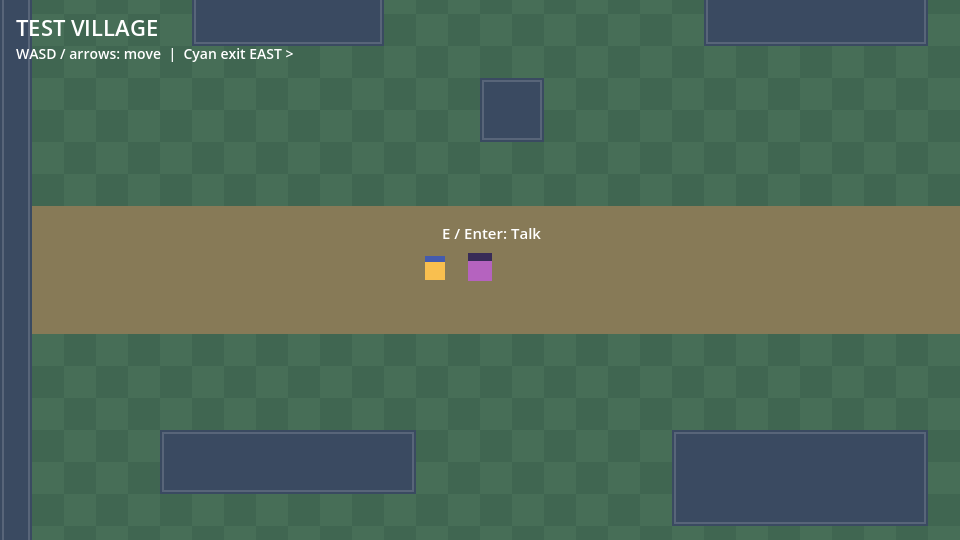
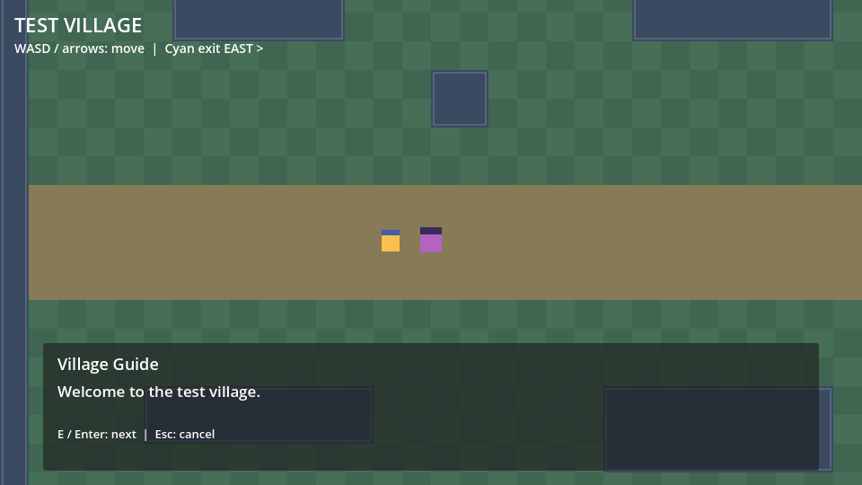
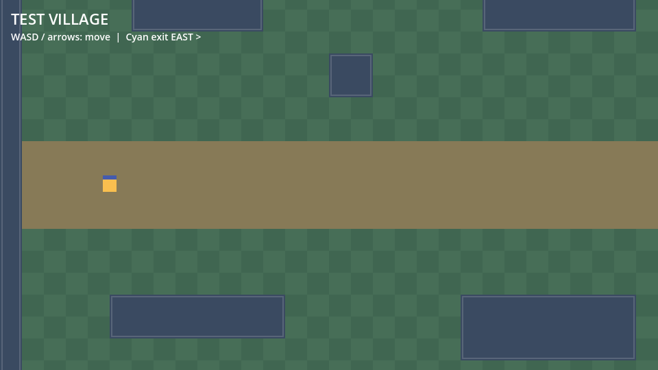
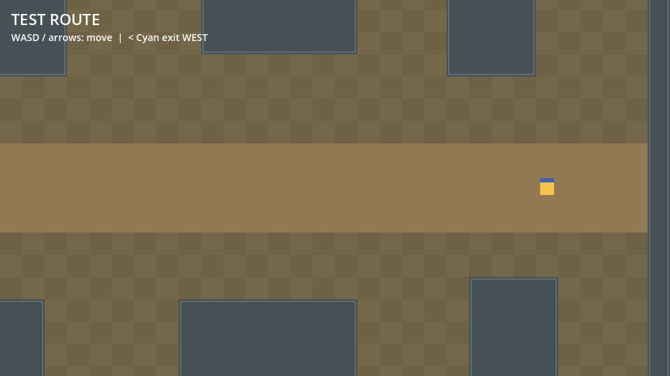

# PokeNavis Godot Client

**Status:** PN-002 first walkable test world was merged in [PR #3](https://github.com/MrLluminati/PokeNavis/pull/3). PN-003 NPC interaction and dialogue were merged in [PR #5](https://github.com/MrLluminati/PokeNavis/pull/5) after Codex tests and owner-reported manual acceptance. This is an offline prototype, not a complete RPG.

## Requirements and launch

- Godot **4.7.2 stable, standard edition** (GDScript; no .NET SDK): https://godotengine.org/download/archive/4.7.2-stable/
- GL Compatibility renderer; no third-party plugins or proprietary assets.
- Open `client/project.godot` in the editor and press **F5**. The project starts in **Test Village**. Press **F6** with `scenes/main.tscn` open to inspect the preserved PN-001 splash screen.

## Controls and navigation

| Input | Result |
| --- | --- |
| W / Up arrow | Move up |
| A / Left arrow | Move left |
| S / Down arrow | Move down |
| D / Right arrow | Move right |
| E / Enter | Talk while close to the Village Guide; advance one dialogue line per press; close after the final line |
| Escape | Close dialogue early |

Movement is 96 pixels per second while a key is held and stops when released. If horizontal and vertical keys are held together, horizontal input takes priority; the player never moves diagonally faster. The camera follows the player and stays within each 1280×896 map. Solid blue-gray blocks and the outer border stop movement.

From the Village starting point, walk **east** along the tan path to the cyan exit. You arrive safely on the west side of **Test Route**. Walk **west** along its path to the cyan return exit; you arrive near the east side of Village. Relaunch starts at the original Village spawn. No progress is saved.

The purple **Village Guide** stands on the Village path at `(480, 448)`, east of the initial spawn. Approach within 48 pixels to see `E / Enter: Talk`. The prompt and interaction require clear line of sight, so a solid blocker between the player and NPC prevents talking. Press E or Enter to open a three-line conversation. Each separate press advances one line; Escape cancels. Movement stops while the panel is open and resumes when it closes. The dialogue text lives in `dialogue/test_villager.json`, separately from the reusable NPC and UI scenes.

The zones use original colored geometry on a 32×32 design grid, with grid-aligned Godot collision shapes. They do not use `TileMapLayer` yet; this keeps the small prototype editable through the shared `scripts/world.gd` layout. The player is one reusable `CharacterBody2D` scene, and the transition trigger is an `Area2D` in each zone. These are temporary engineering defaults, not final art or balance decisions.

## Source layout

```text
client/
  project.godot                 Main scene and WASD/arrow input actions
  scenes/main.tscn              Preserved PN-001 splash scene
  scenes/player.tscn            Reusable player, collision and camera
  scenes/npc.tscn               Reusable solid NPC and proximity prompt
  scenes/dialogue_ui.tscn       Reusable screen-space dialogue panel
  scenes/world/test_village.tscn
  scenes/world/test_route.tscn
  dialogue/test_villager.json   Sample speaker and three dialogue lines
  scripts/player.gd             Cardinal movement in physics updates
  scripts/npc.gd                Interaction range, line of sight and input
  scripts/dialogue_ui.gd        Dialogue display and line progression
  scripts/world.gd              Placeholder maps, blockers and exits
  tests/world_smoke.gd          Focused movement and transition checks
  tests/npc_dialogue_smoke.gd   Focused NPC checks and PN-002 round trip
  tests/npc_visual_capture.gd  Reproducible prompt/panel frames
```

Godot-generated `.godot/` cache files are ignored. Generated `.gd.uid` files are tracked with the scripts.

## Reproduce verification

From the repository root, with Godot 4.7.2 standard on `PATH` as `godot` (or replace it with the executable's full path):

```bash
godot --version
godot --headless --path client --import
godot --headless --path client --quit-after 30
godot --headless --path client --script res://tests/world_smoke.gd
godot --headless --path client --script res://tests/npc_dialogue_smoke.gd
```

In the editor, press F5 and confirm the Village scene displays at 960×540 with no errors. Move with WASD and arrows, try simultaneous horizontal and vertical input, collide with solid blocks and the map edge, and walk through the cyan exits in both directions. Stop and press F5 again to verify the original Village spawn.

For PN-003, approach the purple Village Guide, wait for the prompt, then press E or Enter to open and advance the conversation. Hold the key to confirm it does not skip lines; try movement during the panel, Escape to cancel, then talk again after returning from Test Route. The two focused test scripts above exercise these states programmatically.

## PN-003 verification on 2026-11-04

Windows x86_64, official Godot 4.7.2 stable standard executable `Godot_v4.7.2-stable_win64_console.exe` (`4.7.2.stable.official.ed1daf0bf`):

| Check from repository root | Observed result |
| --- | --- |
| `--version` | Exit 0; printed `4.7.2.stable.official.ed1daf0bf` |
| `--headless --path client --import` | Exit 0; import completed without errors |
| `--headless --path client --quit-after 30` | Exit 0; no script or resource errors |
| `--headless --path client --script res://tests/world_smoke.gd` | Exit 0; PN-002 regression passed all 32 checks |
| `--headless --path client --script res://tests/npc_dialogue_smoke.gd` | Exit 0; 33 checks passed: distance and line-of-sight gating, prompt, key mapping, three-line flow, held-key debounce, movement lock, cancellation after leaving range, NPC collision, transitions and cleanup |
| Editor F5 | Exit not applicable; Village opened in the 960×540 debug window with the NPC visible; editor Output showed zero errors and warnings |
| `--path client --script res://tests/npc_visual_capture.gd --write-movie <temporary-output>.png --quit-after 25` | Exit 0; GL Compatibility rendered 25 frames. Inspected prompt and dialogue panel frames are below. |

The focused test drove interaction through Godot input events and physics frames. At the time of Codex verification, a continuous manual keyboard conversation had **not** been recorded. **Owner follow-up (2026-11-04):** The project owner subsequently reported that the manual in-editor NPC conversation test **passed**; PR #5 was merged afterward. This is owner-reported acceptance evidence, not a test independently rerun by ChatGPT. The screenshots below were produced by the visual capture script, which places the player near the NPC and sends one E key event.





## Actual verification on 2026-11-04

Windows x86_64; official Godot standard executable `Godot_v4.7.2-stable_win64_console.exe`, version `4.7.2.stable.official.ed1daf0bf`:

| Check | Observed result |
| --- | --- |
| `--version` | Exit 0; printed `4.7.2.stable.official.ed1daf0bf` |
| `--headless --path client --import` | Exit 0; import completed without errors |
| `--headless --path client --quit-after 30` | Exit 0; no script or resource errors |
| `--headless --path client --script res://tests/world_smoke.gd` | Exit 0; all 32 checks passed, including key mappings, movement, camera limits/follow, blockers/edges, two-way exits, safe arrivals and relaunch |
| Editor F5 | Village displayed in the 960×540 debug window; the editor Output panel showed zero errors and zero warnings |
| Graphical capture of Village and Route | Both commands exited 0; GL Compatibility rendered 960×540 frames. Inspected frames are in [`docs/screenshots`](../docs/screenshots/). |

The movement and transition checks above were driven by the development test in a physics session. The graphical F5 check established launch and appearance; a continuous manual keyboard traversal was not recorded. The test and editor checks together cover the specified behavior. See [PN-002 specification](../docs/PN-002-SPEC.md) and [Issue #2](https://github.com/MrLluminati/PokeNavis/issues/2).





**Scope:** No quest, encounter, battle, inventory, save system, networking or Pokémon-owned assets were added.
